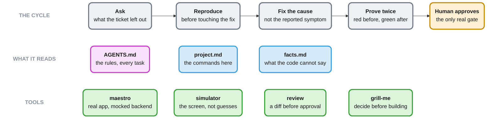

# flutter-agent-harness

How an AI agent is expected to work in a Flutter repo. The point is verification: the agent runs the checks, shows what they printed, and names what it did not check.

```bash
./install.sh ../my-flutter-repo
```

## How it works

Four steps belong to the agent, in grey. The last one, in amber, does not, and nothing the agent does replaces it. Of the files it reads, pink is replaced on every update and blue is yours: written once, then kept current by the agent as it learns.



## The proof

Every handback ends here, and a line nobody ran does not go in it.

```
## Evidence
- `derry linter local` -> 0 issues
- `derry tests local` -> 6319 passed
- `<integration> --flow integration_test/order/add_item.yaml` -> passed
- not checked: Android, the flag-off path
```

Change the structure or the tooling and the diagram changes in the same commit. One that disagrees with the code is worse than none, because people stop reading the code and believe the picture.

## Files

Re-run the installer to update: it replaces its own files and never overwrites yours.

An existing `AGENTS.md` is never overwritten on a first install: the installer writes `AGENTS.md.new` beside it and leaves the merge to you. Once that `.new` is merged and deleted, `AGENTS.md` belongs to the harness and every later run replaces it. `.agents/.harness-version` is how the installer tells the two apart, and it records which harness commit the repo has. Everything the installer is about to touch is copied to a temp directory first, and when there was anything to copy, the undo command is printed at the end.

| file | on update | read when |
|---|---|---|
| `AGENTS.md` | replaced | every task, by every tool |
| `.agents/skills/` | replaced | when the task matches one |
| `.agents/stack.md` | replaced | at project creation or when scaffolding something new, not daily |
| `.agents/.harness-version` | replaced | by the installer only. The harness commit installed here |
| `.agents/project.md` | **kept** | every task. The six commands, the flavors, the mock setup |
| `.agents/facts.md` | **kept** | before designing. Migrations in flight, what is being replaced |
| `.agents/review-misses.md` | **kept** | before reviewing. What a human caught that the AI review missed |
| `derry.yaml` | **kept** | the six command aliases. Written once, only when nothing already defines them |

`AGENTS.md` names no library and no framework, on purpose. Agents deduce the stack from the nearest sibling file, and a stack list in the daily context goes stale while everyone keeps trusting it. `stack.md` holds the choices and nothing links to it.

## Tool support

`AGENTS.md` is read natively by Claude Code, Cursor, Codex, Copilot and Devin. Skills live in `.agents/skills/`, which Cursor, Codex, Copilot, Gemini CLI and Devin all read; Claude Code only reads `.claude/skills/`, so the installer symlinks each skill there.

Gemini CLI reads `GEMINI.md` by default. To point it at `AGENTS.md`, add `.gemini/settings.json` with `{"context":{"fileName":["AGENTS.md","GEMINI.md"]}}`. The installer does not write this.

## Skills

A skill loads when the work reaches it, never at the start of every task.

| skill | loads when | what it does |
|---|---|---|
| `maestro` | a journey has no flow yet | write and run an integration flow against the real app with a mocked backend |
| `simulator` | a selector would be a guess | drive the running app to see what is actually on screen |
| `review` | a diff is waiting for approval | review it for correctness and scope, within the diff boundary. Not named `code-review`, which would shadow the built-in |
| `grill-me` | a decision is still open | settle it before implementing, three rounds maximum |

`simulator` ships `ma`, a CLI over [AXe](https://github.com/cameroncooke/AXe) that compacts the accessibility tree (around 160 KB down to a few KB), waits on screen state instead of sleeping, batches steps into one round trip, and recovers when the simulator's accessibility bridge dies. It needs Node 18 or newer, and AXe: `brew install cameroncooke/axe/axe`.

`ma` knows how to drive a simulator; it does not know your app. The skill tells the agent to write that down in `.agents/skills/app-navigation/SKILL.md` as it learns: the recipes, the selectors per screen, the gotchas that cost a session. That file is yours. The skill also tells the agent to link it into `.claude/skills/` when it creates it, and every later install re-links it along with the rest.

## Not here yet

- **CI.** The integration suite needs a scheduled sharded job that emits JUnit XML, and that differs per project.
- **Android.** `ma` and the Maestro runner are macOS and the iOS simulator. Nothing here drives an emulator.
- **Tests for `ma`.** `compactDescribeUi` is a pure function and should be pinned by a saved AXe tree and its expected compact output. The harness asks for this and does not yet do it.
- **An AXe version floor.** "1.8.0 or newer" is prose in a markdown file, not a check that runs.

Built at Navalia for the Flutter apps we ship.
